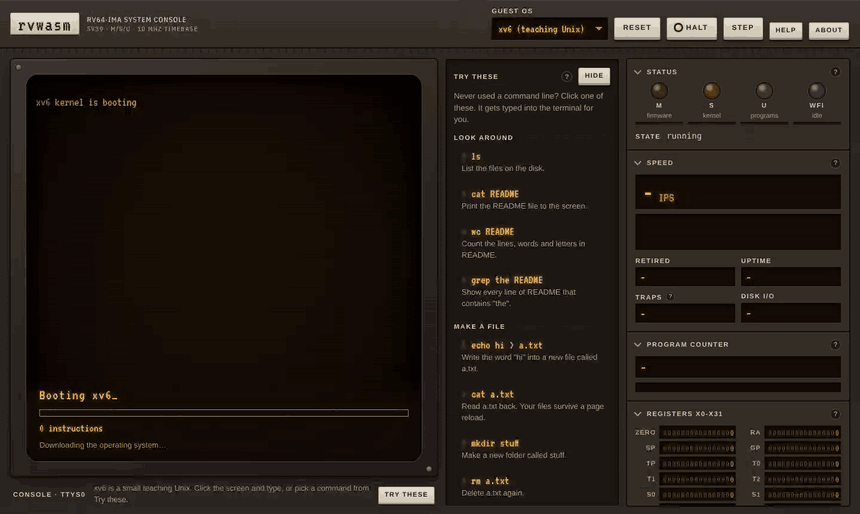
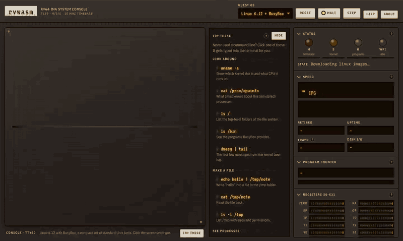
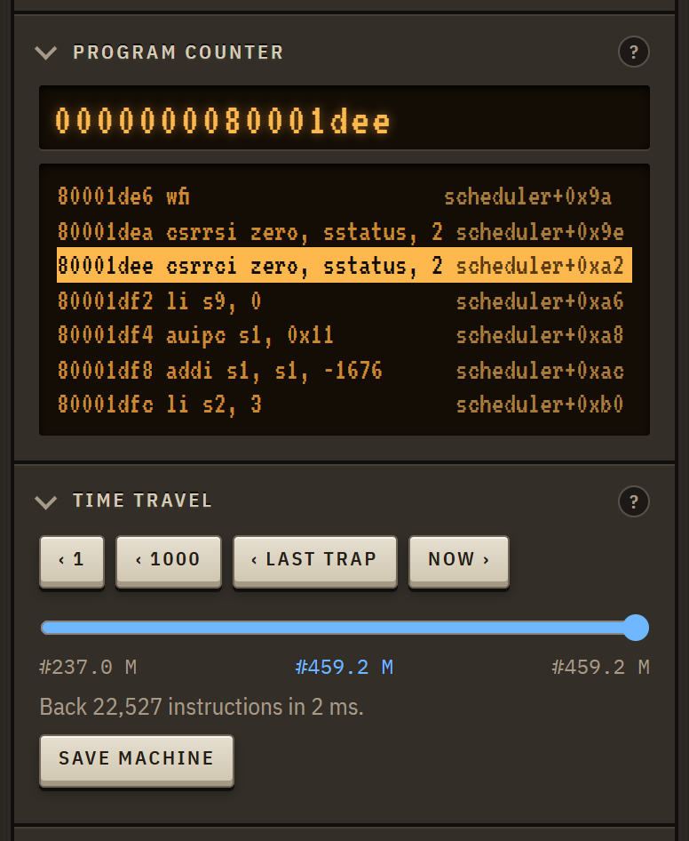
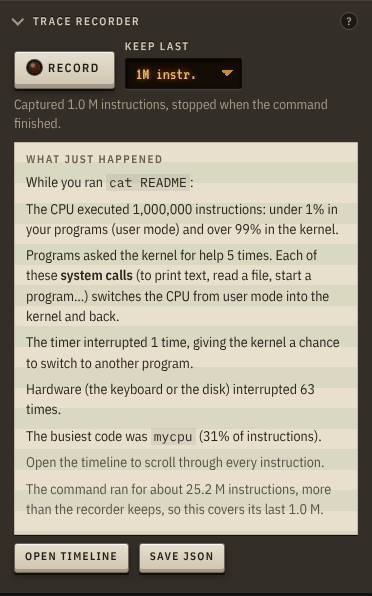
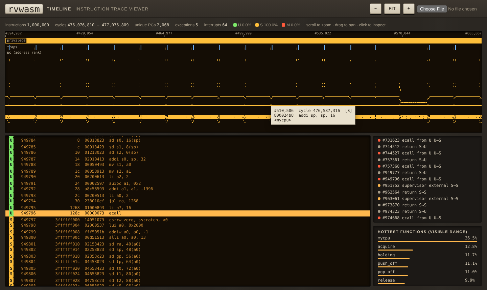

# rvwasm

A RISC-V computer that runs in a browser tab. The CPU is written in Rust, compiled to
WebAssembly, and good enough to boot xv6 and Linux. It can also run backwards: halt it and
step back through the last couple of hundred million instructions, exactly as they ran.

**Try it: [ps12007.github.io/rvwasm](https://ps12007.github.io/rvwasm/)**



That's xv6, MIT's teaching Unix, booting from a virtio disk image and taking commands. The
page is built like the front panel of an old workstation: an amber CRT for the console,
lamps that show whether the CPU is running the kernel (S), a program (U) or firmware (M),
and recessed readouts for the registers, the program counter and the instruction rate.

You don't need to know Unix to use it. The **Try these** drawer has commands for each
system grouped by what they do, each with a one-line explanation; clicking one types it
for you. Every panel has a **?** that explains what it shows in plain words, and a short
tour runs on your first visit. Keyboard shortcuts (space to halt, S to single-step, B to
step back, R to record) are under Help.

## What it emulates

- An RV64GC hart (RV64IMAFDC with Zicsr and Zifencei): the base integer ISA,
  multiply/divide, atomics, single- and double-precision floating point, and 16-bit
  compressed instructions. That is the ISA standard RISC-V Linux distributions target.
- The bit-manipulation extensions Zba, Zbb, Zbc and Zbs (shifted adds, count/rotate/
  byte-reverse, carry-less multiply, single-bit ops) and Zicond (branchless select), all
  part of the RVA23 profile. The Linux kernel sees them in the device tree and patches in
  its Zbb string routines at boot.
- Machine, supervisor and user mode, with traps, delegation and interrupts.
- Sv39 paging, with the accessed/dirty bits updated in hardware.
- A 16550 UART, the CLINT timer, a PLIC, and a virtio-mmio block device, at the same
  addresses as QEMU's `virt` board.
- The Sstc timer extension, which current xv6 relies on.

It passes all 334 tests in the official [riscv-tests](https://github.com/riscv-software-src/riscv-tests)
suites for this ISA (rv64ui, um, ua, uf, ud, uc, si, mi, uzba, uzbb, uzbc, uzbs, uzicond, in both
the physical and virtual-memory variants), and xv6's own `usertests` runs to the end with ALL TESTS PASSED. CI checks both on
every push.

Everything the page runs is built with compressed instructions, as real RISC-V software is:
they make up 59% of xv6's instructions and 55% of the Linux kernel's and BusyBox's. Each
16-bit instruction is expanded to the 32-bit one it stands for through a 64K-entry table
built once, so compressed code runs about as fast as uncompressed code.

Floating point is done in integer arithmetic (`softfloat.rs`) rather than with the host's
floats: all five rounding modes, the exception flags, tininess after rounding, and
NaN-boxing of single-precision values. Host floats only round to nearest, raise no flags,
and don't promise the same NaN bits everywhere, and the native and browser builds must give
bit-identical results for saved machines and time travel to work. Unit tests check it
against the host on 600,000 random operations, and the other rounding modes against each
other on 800,000 more.

## Linux



Pick "Linux 6.12 + BusyBox" in the header. There is no OpenSBI here: when the kernel makes
an SBI call, the emulator answers it directly, so Linux starts in supervisor mode on a
device tree the emulator writes at boot. The kernel is built from `tinyconfig` with its
FPU support on, and userland is BusyBox on musl, compiled for rv64gc with hardware floating
point (`awk 'BEGIN { print 4 * atan2(1, 1) }'` goes through musl's libm). It reaches a shell
after about 100 million instructions.

You can also boot your own build: open "Load your own" in the side panel and pick a
bare-metal ELF (with an optional disk image), a Linux `Image` (with an optional initramfs),
or a machine saved earlier. The files never leave your browser.

## Running backwards



Halt the machine and the **Time travel** panel lets you step back one instruction or a
thousand, jump to just before the last trap, or drag the slider to any point the page still
remembers (about 200 million instructions of xv6, in 64 MB). Registers, memory and the disk
are exactly as they were. On the right, "last trap" has stopped xv6's scheduler just after
it turns interrupts on, which is where the timer interrupt that was waiting gets taken.
Pressing Run replays at full speed back to the present, retyping what you typed at the
cycles you typed it, and carries on.

<br clear="right">

This works because a run is exactly repeatable: the same disk and the same keystrokes at the
same cycles give the same execution, however the host slices its calls into the emulator.
The page checkpoints the machine's small state (registers, CSRs, TLB, devices: about 20 KB)
every million instructions, and saves a RAM or disk page's old contents the first time it is
written after a checkpoint. Going back writes those pages back, newest first, to the nearest
checkpoint before the target, then replays to the exact instruction. Stepping back one
instruction takes a few milliseconds; jumping back 150 million takes about 10.

`tests/timetravel.rs` boots xv6, types a command that writes a file, and checks that runs
sliced at random points, snapshot round trips, and every point it travels back to match a
plain run bit for bit (registers, all of RAM and the disk). It runs in CI.

The same state can be saved to a file. **Save machine** downloads one from the page, and
the command line writes one with `--save`; running the file carries on where it stopped:

```bash
rvwasm run build/xv6/kernel/kernel --disk build/xv6/fs.img --save xv6.snap   # Ctrl-A x to stop
rvwasm run xv6.snap
```

Pages that are one repeated byte, or that shrink with run-length encoding, are stored that
way, so xv6 after boot is 3 MB and Linux 9 MB.

## Looking inside



Press Record, run a command, and the recorder stops by itself when the shell prompt comes
back. It then tells you in plain language what the CPU did: how many instructions ran in
the kernel versus your program, how many system calls the program made, how often the timer
and the hardware interrupted, and which function was busiest. For `cat README` on xv6 it's
almost all kernel: printing goes through the serial driver one character at a time.

Open timeline shows the same recording instruction by instruction: privilege level across
the top, trap markers, where the PC was, and the disassembled, symbolised instructions
underneath. Below, a user program's `ecall` lands in xv6's trampoline at `0x3ffffff000`.

<br clear="right">



The command-line runner records the same format:

```bash
rvwasm run build/xv6/kernel/kernel --disk build/xv6/fs.img --trace 200000 --trace-out trace.json
```

## Speed

It's a straightforward interpreter. On my 4-core cloud VM:

| | million instructions per second |
|---|---:|
| native (`rvwasm bench`) | ~190 |
| WebAssembly in Chromium | ~130 |
| WebAssembly in Node 22 | ~120 |

So the browser build runs at about two thirds of native speed. Recording history for time
travel costs about 5% (a bit test on each store, and a checkpoint every million
instructions). Both builds run identical
workloads (nine programs from riscv-tests/benchmarks plus an xv6 session) through the same
Rust code in `rvcore::bench`, and only guest execution is timed. You can run the browser half
yourself on the [benchmark page](https://ps12007.github.io/rvwasm/bench.html); CI publishes
both sets of numbers in each run's summary.

## Building it

You need Rust, and on Ubuntu 24.04:

```bash
sudo apt-get install gcc-riscv64-unknown-elf picolibc-riscv64-unknown-elf \
  gcc-riscv64-linux-gnu flex bison bc libelf-dev rsync
git submodule update --init --recursive
cargo build --release
```

Then any of:

```bash
# the ISA tests
make -f tests/riscv-tests.mk -j"$(nproc)"
./target/release/rvwasm test build/riscv-tests/*

# xv6 on your terminal (Ctrl-A x quits)
./scripts/build-xv6.sh
./target/release/rvwasm run build/xv6/kernel/kernel --disk build/xv6/fs.img

# Linux + BusyBox
./scripts/build-linux.sh
./target/release/rvwasm run build/linux/Image --linux --initrd build/linux/initramfs.cpio.gz

# the web page (needs wasm32-unknown-unknown and wasm-pack)
./scripts/build-web.sh
python3 -m http.server -d web 8000
```

`build-xv6.sh` builds xv6 with its own, unmodified Makefile (rv64gc). `build-linux.sh`
shallow-clones Linux v6.12, musl 1.2.5 and BusyBox 1.36.1 (the last two from their GitHub
mirrors, pinned to exact commits).

## How it's put together

- `crates/rvcore` is the machine. `cpu.rs` has the run loop, traps and CSRs, `exec.rs` the
  integer instructions, `fpu.rs` and `softfloat.rs` floating point, `rvc.rs` the compressed
  instructions, `mmu.rs` the page-table walker and
  TLBs, `devices/` the UART, CLINT, PLIC and virtio disk, and `linux.rs` the SBI firmware and
  device tree. `snapshot.rs` saves and restores the machine, `journal.rs` keeps the old
  contents of written pages, and `timetravel.rs` puts the two together.
- `crates/rvcli` is the `rvwasm` command: `test`, `run` and `bench`.
- `crates/rvweb` is the wasm-bindgen wrapper the page talks to.
- `web/` is the site. The emulator runs in a Web Worker so typing stays responsive, and
  when the guest is idle in `wfi` it stops burning CPU and lets guest time follow the clock.
  xv6's disk is saved in the browser a couple of seconds after the guest stops writing, so
  files are still there after a reload (the Disk panel can download or reset it).

A few choices that made it fast enough. Instructions run in chunks that stop at any trap,
return or device write, which is when interrupts get rechecked; between those points nothing
else is looked at. Each TLB entry is only filled once the permission checks for the current
mode have passed, so a hit is a compare and an add, and the whole TLB is flushed by bumping a
counter. Instruction fetch remembers the page it's in. Guest time is derived from the
instruction count, and the position within a chunk carries over between calls, so a run is
deterministic: the same disk and the same keystrokes at the same cycles give the same result
every time. Time travel is built on that.

## Not done yet

- No vector (V) extension.
- One hart only.
- Time travel only reaches the recent past (it is bounded by memory), and reloading the
  page starts from scratch unless you load a saved machine.

## License

MIT. riscv-tests, xv6, Linux, musl and BusyBox keep their own licenses.
